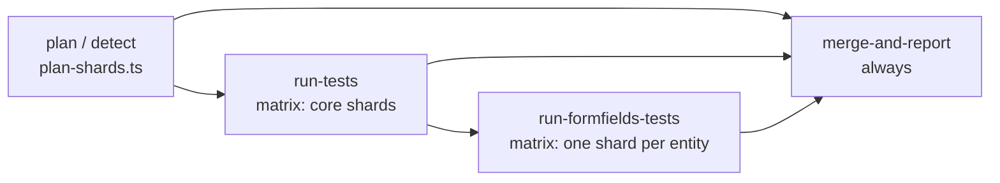

# CI Pipelines

> **Purpose:** How this repo's CI is built — the four sharded GitHub workflows, the shard planner, the formFields carve-out and its sequencing, the Jenkins pipelines (environments, triggers, locks, the sharded engine), required secrets, and timeouts.
> **Read when:** Editing any `.github/workflows/*`, `Jenkinsfile*` or `scripts/plan-shards.ts`; judging whether "CI is green" actually covers your change; adding a shared-config test suite.
> **Size budget:** 40k chars (hard cap 60k)
> **Last verified:** 2026-10-28 @ 566df8c

All figures in tables below are generated (`npm run docs:refresh`), never hand-typed. If a number looks wrong, refresh; do not edit it.

## 1. Suite size right now

<!-- GEN:suite-totals:START -->
**956 tests** in **35 spec files** (UI 525 · RBAC 431)
<!-- GEN:suite-totals:END -->

<!-- GEN:tag-counts:START -->
`@smoke` 51 · `@regression` 924 · `@prodSafe` 54
<!-- GEN:tag-counts:END -->

## 2. Pipeline matrix (generated from the workflow / Jenkinsfile text)

<!-- GEN:workflow-matrix:START -->
| Pipeline file | Trigger | Scope (`--grep`) | `--workers` | Sharded by planner |
|---|---|---|---|---|
| `dev.yml` | push → dev | @smoke | 1 | no |
| `main.yml` | manual | full suite / selective | 2 | yes |
| `prod.yml` | manual | @prodSafe | 2 | no |
| `qa.yml` | push → qa | @regression | 2 | yes |
| `runner-image-canary.yml` | manual + schedule | no tests | — | no |
| `sandbox.yml` | push → sandbox | full suite / selective | 2, dynamic | yes |
| `stage.yml` | push → stage + manual | full suite / selective | 2 | yes |
| `staging-promotion-gate.yml` | manual | full suite / selective | — | no |
| `Jenkinsfile` | Jenkins | @prodSafe, @regression, @smoke | 2 | yes (listed branches only) |
| `Jenkinsfile.prod` | Jenkins | @prodSafe | 2 | no |
| `Jenkinsfile.qa` | Jenkins | @regression | 2 | no |
| `Jenkinsfile.sandbox` | Jenkins | full suite / selective | 1 | no |
| `Jenkinsfile.staging` | Jenkins | full suite / selective | 2 | no |
<!-- GEN:workflow-matrix:END -->

CLI `--workers` always wins over `playwright.config.ts` and the `WORKERS` env var. `staging-promotion-gate.yml` passes no `--workers`, so it is the one path where `WORKERS` is actually read. "Sandbox" workers are decided at runtime (`dynamic`).

## 3. Branch strategy and which pipeline protects what

```
feature/* → dev → qa → stage → prod → main        sandbox = pre-PR check, reset to dev each time
```

| Branch | Primary CI | Scope (from the workflow, verified) |
|---|---|---|
| `sandbox` | `sandbox.yml` (push) | Selective via `.github/scripts/detect-tests.sh`; escalates to `--grep @regression` when core files change; falls back to `@smoke` with no changed files |
| `dev` | `dev.yml` (push) | `@smoke` |
| `qa` | `qa.yml` (push) | `@regression` |
| `stage` | `stage.yml` (push + manual) | Full suite, no `--grep` |
| `prod` | base `Jenkinsfile` (branch `prod`) | `@prodSafe`. `prod.yml` is a manual fallback (`workflow_dispatch`) |
| `main` | base `Jenkinsfile` (branch `main`) | Full suite, no `--grep`. `main.yml` is manual only and also runs the full suite |

Jenkins: the base `Jenkinsfile` (used by every branch of the multibranch job) runs tests only for `prod`, `main` and manual builds; `Jenkinsfile.qa`, `.staging`, `.prod`, `.sandbox` are manual-only fallbacks. Environments, locks and sharding: section 5.1. `staging-promotion-gate.yml` is a different file from `stage.yml`: manual-only, runs against `STAGING_*` secrets, then after a human approval in the `production-approval` GitHub Environment auto-merges `staging` into `prod`. Treat its blast radius accordingly.

"CI passed" means different things per branch (rule 23 in CLAUDE.md): dev proves smoke only; qa proves `@regression`; only stage / main / the Jenkins `main` run (sharded or not) prove the full suite.

## 4. The four sharded workflows (`qa.yml`, `stage.yml`, `main.yml`, `sandbox.yml`)

GitHub-hosted jobs have a hard, non-configurable 6-hour ceiling; `timeout-minutes` above 360 does nothing. A single-job run of the regression/full suite exceeded it and was killed. Sharding is the structural fix.



| Job | Needs | Runs when | `timeout-minutes` |
|---|---|---|---|
| `plan` (`detect` in sandbox) | none | always | 15 (`plan`); sandbox `detect`: none set (GitHub's default applies) |
| `run-tests` | `plan` / `detect` | all plan outputs present (sandbox: also `run_scoped_tests == 'true'`, i.e. skipped when only formFields was selected) | 180 |
| `run-formfields-tests` | `run-tests` (sandbox: `detect`, `run-tests`) | `!cancelled()`, i.e. after core shards finish in ANY result; sandbox also requires `run_formfields_track == 'true'` | 180 |
| `reset-field-config` | `run-tests`, `run-formfields-tests` | `always()` (sandbox: also `run_formfields_track == 'true'`) | 35 job / 25 step |
| `merge-and-report` | all of the above incl. `reset-field-config` | `always()` | 30 |

- **Why formFields runs after core, not beside it:** both tracks starting together put every core and formFields job through `globalSetup` against one backend at once, which produced 429s. `needs` alone would skip formFields on any core failure, so `if: !cancelled()` is required. Cost: wall-clock roughly doubles. Decision record: [ADR 0007](./adr/0007-sequence-formfields-after-core.md).
- **`merge-and-report`:** downloads every shard's blob report, `npx playwright merge-reports --config=merge.config.ts`, aggregates misc-errors (`scripts/merge-misc-errors.ts`), then `npm run history:sync || true` and `npm run notify || true`. `allure-playwright` is deliberately excluded from the merge config. See [REPORTING.md](./REPORTING.md).
- **`reset-field-config`** (qa, stage, main, sandbox; not `prod.yml`): after both tracks it runs `npm run reset:field-config -- --env <env>` (main adds `--confirm-prod`, `environment: production`) to blank the 18 dedicated form-field limits, uploads artifact `field-config-reset-<env>`. Job- and step-level `continue-on-error`, the step always exits 0; `merge-and-report` downloads the artifact with a `continue-on-error` step. [ADR 0009](./adr/0009-field-config-reset-and-account-lock.md). Unproven: see "Open" below.
- **Concurrency groups** (`cancel-in-progress: false`): `kylas-qa` (`qa.yml`), `kylas-staging` (`stage.yml`, `sandbox.yml`), `kylas-prod` (`main.yml`, `prod.yml`). `dev.yml` and `staging-promotion-gate.yml` are not in any group, and no group sees Jenkins: Jenkins has its own account locks and collision guard (section 5.1).
- **Open (not facts, [KI-34](./KNOWN_ISSUES_ACTIVE.md)):** whether job-level `continue-on-error` protects the run conclusion on a job timeout; whether an approval-waiting run holds its group; whether `main.yml` needs a separate approval for the reset job (then `merge-and-report` waits); `always()` after force-cancel; a pending `stage` run can be displaced by a `sandbox` push. Timeouts 25/35 min are guesses; `merge-and-report` now waits up to that long.
- **Browser install is bounded** (all workflows with the step): `bash .github/scripts/install-playwright-browsers.sh --with-deps` under a step `timeout-minutes: 10`: 2 attempts x 300 s (last attempt clamped to the remaining budget, 570 s total, worst case about 576 s; changed from 3 x 180 s because of a slow apt mirror, observed in sandbox run 39934344278), 5 s backoff, apt connection timeouts, leftover apt-get reaped after a timeout, 60 s dpkg lock wait; all attempts failing fails the job with an error annotation. Values come from measured healthy installs (24-139 s). **Apt mirror override** (added 2026-10-26): the apt mirror azure.archive.ubuntu.com on the runners regularly degrades to a trickle that apt timeouts cannot catch (5 of 21 installs slow in sandbox run 39934344278, 159-216 kB/s or stalled; run 40277774212 was still in progress when counted). With `--with-deps` the script first rewrites every file under `/etc/apt` naming it (e.g. `apt-mirrors.txt`) to `http://archive.ubuntu.com/ubuntu/`, security pocket included, logs each changed file, and fails with an error annotation if an azure reference survives a rewrite that changed at least one file; with nothing to rewrite it logs that and continues. Disable with `APT_MIRROR_OVERRIDE=off` in the step environment (needs a workflow edit) or by changing the script default. See the 2026-10-07 entry in [sharding-and-locks.md](./known-issues/sharding-and-locks.md).
- **Runner image is a repository variable** (all 25 jobs in the 7 workflows): `runs-on: ${{ vars.RUNNER_IMAGE || 'ubuntu-24.04' }}`. The fallback keeps the 24.04 pin if the variable is missing or empty; nothing moves to a newer image by itself. **Changing `RUNNER_IMAGE` moves every pipeline at once, `prod.yml` and `main.yml` included.** Why: `ubuntu-latest` migrates to Ubuntu 26.04 between 2026-10-19 and 2026-11-19 (GitHub changelog 2026-09-17) and Playwright 1.60 fails there (`does not support chromium on ubuntu26.04-x64`, main run 39456246717). Set it with `gh variable set RUNNER_IMAGE --body ubuntu-24.04`; roll back by setting it back, no commit. **Removal / move condition:** Playwright supports 26.04 and the pipeline has passed one sandbox run on `ubuntu-26.04`.
- **Runner image canary** (`runner-image-canary.yml`): `workflow_dispatch` plus Mondays 05:17 UTC; installs the browsers for four (Playwright, image) pairs: `ubuntu-24.04` + locked, `ubuntu-26.04` + locked, `ubuntu-26.04` + newest, `ubuntu-latest` + newest (newest via `npm install --no-save`, repo files unchanged; no secrets, no tests, no writes) and prints a `VERDICT Playwright <version> supported/NOT supported on <os>` line per pair. Only 24.04 + locked red is an alarm; the other pairs end green with a warning annotation and the VERDICT line. Scheduled workflows run from the default branch (`dev`). The install script stops after the first unsupported-OS failure (a re-run cannot help).
- **Shard completeness** (`merge-and-report` in qa, stage, main, sandbox): `.github/scripts/verify-shard-completeness.sh <env> <core shards> <formFields shards>` counts downloaded blob zips against expected (core + the formFields entities that ran; sandbox: the selected count, qa/stage/main: 6), writes `reports/<env>/shard-completeness.json` and annotates. It always exits 0 so merge/history/notify/reset still run (a failing step would skip the merge and leave only a "report not available" email); the email and history react to the JSON instead ([REPORTING.md](./REPORTING.md)).
- Every shard uploads `blob-report-*`, `misc-errors-*` and `playwright-test-results-*` artifacts; the merged report is `playwright-report-<env>`.

### 4.1 Shard planner (`scripts/plan-shards.ts`)

Replaces Playwright's blind count-based `--shard=N/M`. It runs `playwright test --list --reporter=json`, drops every file under the shared-config suites' directories, then first-fit-decreasing bin-packs the remaining spec FILES into bins of at most 125 tests <!-- doc-figure-ok --> (`--tests-per-shard`, derived from measured throughput at 2 workers targeting ~90 min per shard). A file is never split. Output (`shard_total`, `shards_json`, `test_count`) goes to `$GITHUB_OUTPUT`, or to stdout locally. Current plan:

<!-- GEN:shard-plan:START -->
| Scope | Core shards (file-atomic) | Tests per core shard | formFields shards (fixed, one per entity) |
|---|---:|---|---:|
| `--grep @regression` (qa, escalated sandbox) | 5 | 124 / 125 / 125 / 123 / 28 | 6 |
| full suite (stage, main) | 5 | 125 / 123 / 125 / 124 / 42 | 6 |
<!-- GEN:shard-plan:END -->

Run it locally with `npx ts-node scripts/plan-shards.ts --grep @regression` (read-only). Decision record: [ADR 0003](./adr/0003-file-atomic-shard-planner.md).

### 4.2 formFields carve-out

The Form Field Limit tests mutate one shared, account-wide field configuration. A cross-process file lock only protects workers on the same filesystem, and each CI shard is its own VM, so a UI file and its RBAC file on different shards raced. The fix is structural:

- `config/sharedConfigSuites.json` lists the suite directories and entities. `plan-shards.ts` reads it for its exclusion, so no workflow edit can leak those files back into bin-packing.
- Each sharded workflow has a **fixed** `run-formfields-tests` matrix (`entity: [lead, contact, company, deal, task, productsAndServices]`), one shard per entity running that entity's UI + RBAC file pair together via explicit paths.
- `scripts/check-formfields-matrix-sync.ts` (`npm run check:formfields-matrix-sync`) fails if a workflow's matrix drifts from the JSON. Run it when adding an entity.
- Why not a dynamic matrix: it would add a `needs: plan` hop to a job that previously had none. Sandbox is the exception (its `detect` job is already a dependency).

Decision record: [ADR 0002](./adr/0002-formfields-carve-out-from-sharding.md); lock design: [ADR 0005](./adr/0005-heartbeat-based-lock.md); serial scoping: [ADR 0006](./adr/0006-serial-sub-blocks.md); dedicated fields: [ADR 0001](./adr/0001-dedicated-custom-fields.md). History: [known-issues/sharding-and-locks.md](./known-issues/sharding-and-locks.md).

### 4.3 Sandbox's two decide branches

`sandbox.yml`'s `detect` step runs `detect-tests.sh` to choose a target, then:

1. **Escalated** (`TARGET == "--grep @regression"`, triggered by changes under `src/core/`, `src/fixtures/`, `src/auth/`, `playwright.config.ts`, or critical `config/config.ts` edits): calls the planner and enables the formFields track.
2. **Selective** (any other target): planner-free (the planner would drop explicitly selected paths). `.github/scripts/split-formfields-target.sh` splits `$TARGET` by the `config/sharedConfigSuites.json` path prefixes (`tests/ui/formFields/`, `tests/rbac/formFields/`, not a grep substring): formFields paths go to the per-entity matrix (`run_formfields_track=true`), the rest goes to `run-tests` as one `--shard=1/1` shard. The step fails loudly if formFields count + scoped count != original count (never run twice, never dropped). Since 2026-10-07; before that a formFields selection ran every formFields test as one job (run 37658909999).

   **Sandbox runs only the selected entities (2026-10-08, run 37753304635: a `ProductsAndServicesPage.ts`-only change had moved every formFields test).** `detect-tests.sh` maps `tests/{ui,rbac}/formFields/<entity>FieldLimits(.rbac).spec.ts` and `<entity>FormFieldLock.ts` to that entity; a `src/modules/**` or `src/data/factories/**` file to the entities whose formFields spec files import it (derived from the real import text, so a file imported by several entities selects each); shared files (`FormFieldsConfigPage.ts`, `formFieldLockFactory.ts`, `formFieldsTestLock.ts`, `config/sharedConfigSuites.json`, any unrecognised file in the formFields dirs) and escalated runs select all. It writes `formfields_entities_json` (placeholder `["none"]` when nothing is selected, never `[]`) to `$FORMFIELDS_ENTITIES_OUT`; the workflow cross-checks it against the entities the split paths cover, uses it as the matrix, and counts its length as the expected formFields blobs. `reset-field-config` still resets all 18 fields. qa/stage/main keep the fixed 6-entity matrix.

| Case | `run_scoped_tests` | `run-tests` | `run-formfields-tests` (sandbox: selected entities; qa/stage/main: 6) | blobs expected by `merge-and-report` |
|---|---|---|---|---|
| formFields only | false | skipped (not failed) | runs (`!cancelled()`) | 0 + E |
| formFields + other module | true | other module only, 1 shard | runs | 1 + E |
| escalated `@regression` | true | planner shards, formFields excluded | runs | N + 6 |

`E` = selected formFields entities on sandbox (1-6); fixed 6 on qa/stage/main.
| no formFields (path target or `@smoke`) | true | as before | skipped | 1 |

`--grep @smoke` (fallback) still matches 18 `@smoke` formFields tests inside the single scoped shard; deliberately unchanged (small, read-only).

Workers: 2 when the rest-of-suite count is above 50, else 1; the formFields track is always 2. `detect-tests.sh` maps changed files to modules (module dir, `tests/ui/<m>/`, `tests/rbac/<m>.rbac.spec.ts` or `tests/rbac/<m>/`, factories via a singular→plural table) and also greps formFields specs for import dependencies (a page object/factory they import selects formFields too).

## 5. Other pipelines

- `dev.yml`: `@smoke`, one job, no sharding. `prod.yml`: `@prodSafe` only, manual, `environment: production`.
- `main.yml` jobs carry `environment: production`. If that environment has required reviewers, each job can raise its own approval prompt (not checkable from the repo).
- Base `Jenkinsfile`: per-stage timeouts (Checkout, Install, Setup Environment, Clear Auth State, Detect Tests) and a 24-hour `Approval Gate`; the unsharded `Run Tests` computes its own timeout from the test count; the pipeline-wide timeout is a 48-hour backstop only, so it never needs syncing with suite growth. Unsharded branch → test selection is an if/else chain mirroring the GitHub workflows (dev `@smoke`, qa `@regression`, prod `@prodSafe`, sandbox via `detect-tests.sh`, others full). Sharding, locks and the guard: section 5.1.
- Every pipeline ends the same way: `npm run estimate-duration` (before tests), tests, `npm run history:sync`, `npm run notify`, archive the report.
- Git hooks in `scripts/hooks/` (`pre-commit`, `pre-push`) are installed into `.git/hooks/` (`core.hooksPath` is unset).

### 5.1 Jenkins: environments, locks and the sharded engine

Decision record: [ADR 0012](./adr/0012-jenkins-sharded-runs-locks-and-guard.md). Operating steps: [RUNBOOK.md](./RUNBOOK.md#jenkins-sharded-runs-setup-and-operation). Status: run live on QA on 2026-10-28 (maintainer's report); two core lanes at once still unproven: [KI-47](./KNOWN_ISSUES_ACTIVE.md).

**Who runs tests.** In the base `Jenkinsfile`, Install, Setup Environment, Clear Auth State, the Approval Gate and the test stages admit `prod`, `main` and manual builds (`UserIdCause`) only. Automatic builds of any other branch only check out.

**Environment, account lock and guard.** One function (`kylasEnvFor()`) maps branch to environment; the lock is `kylas-<env>-account` and the guard checks the GitHub workflows that use that environment.

| Branch (base `Jenkinsfile`) | Env | GitHub twin (env) | Guard checks |
|---|---|---|---|
| `main` | prod | `main.yml` (prod) | `main.yml`, `prod.yml` |
| `prod` | prod | `prod.yml` (prod) | `main.yml`, `prod.yml` |
| `stage` | staging | `stage.yml` (staging) | `stage.yml`, `sandbox.yml`, `staging-promotion-gate.yml` |
| `sandbox` | staging (was QA until 2026-10-28; `sandbox.yml` uses staging) | `sandbox.yml` (staging) | same three staging workflows |
| `dev` | qa | `dev.yml` (qa) | `qa.yml`, `dev.yml` |
| `qa` | qa | `qa.yml` (qa) | `qa.yml`, `dev.yml` |
| other (feature branch, manual) | qa | none | `qa.yml`, `dev.yml` |

`Jenkinsfile.prod` (prod), `.qa` (qa), `.staging` and `.sandbox` (staging) take the same lock and guard. Remaining difference from the twins: unsharded Jenkins `dev` runs `--workers=2`, `dev.yml` runs 1 (the sharded path uses 1).

**Selection** (`scripts/jenkins-resolve-selection.sh`, used by the sharded path; the unsharded path keeps the chain above): main and stage full suite; qa `@regression`; dev `@smoke`; prod `@prodSafe`; sandbox `detect-tests.sh` (+ `split-formfields-target.sh`); other branches full. Core workers and `--timeout` follow the twin (main 2/90000, stage and qa 2/120000, dev 1/90000, prod 2/90000, sandbox 2 above 50 core tests else 1 and no `--timeout`). Sandbox fails the build if `origin/dev` cannot be fetched or compared; `--grep @smoke` only when the diff is genuinely empty.

**Which builds shard.** Only branches listed in the Jenkins global variable `KYLAS_SHARDED_BRANCHES` (comma separated; unset means none), and only when the build may run tests (the rule above: `prod` and `main` on any trigger, others manual). `KYLAS_SHARDING=off` disables sharding everywhere. An automatic build of a listed branch other than `prod`/`main` stays unsharded and skips tests, as today.

| Parameter | Meaning |
|---|---|
| `CORE_LANES`, `FF_LANES` | Concurrent core shards / formFields entities, integer 1-4, default 2; anything else is refused |
| `SHARDED_TEST` | Manual build of a branch not in the list: use the engine, QA only (refused if the branch resolves to staging or prod) |
| `TEST_GREP`, `FF_ENTITIES` | `SHARDED_TEST` only: restrict the core track (letters, digits, `_@.-`); formFields entities from `config/sharedConfigSuites.json`, or `none`; the run is marked partial. No effect on listed branches |

**Sharded run order.** Resolve Mode (after Checkout, validates the settings) → Install → Setup Environment → Clear Auth State → Approval Gate → `Sharded Run`: account lock → collision guard → selection and `plan-shards.ts` (`GITHUB_OUTPUT` pointed at a file, `scripts/jenkins-shard-plan.ts` turns it into lines) → one source stash → `jenkins-heavy-run` lock → core lanes → guard → formFields lanes (after core in any result, ADR 0007) → heavy lock released → guard → `reset:field-config` (once, only if the formFields phase started, in a `finally`, 25-minute timeout, a failure only warns) → account lock released. Then `post`: unstash and rename blob zips and misc-errors per shard (GitHub's names), `verify-shard-completeness.sh`, `merge-reports --config=merge.config.ts`, `merge-misc-errors.ts`, then `history:sync` and `notify` once. `estimate-duration` is skipped. Lanes take the heaviest unit first onto the lightest lane. Each shard runs in its own workspace (`kylas-<branch>-core-<n>` / `-ff-<entity>`) with its own `.env` (without the mail secrets), `npm ci`, `storageStates` and `.locks`, under a 180-minute timeout.

**Locks and guard.** Order is always account lock, then guard, then (sharded only) `jenkins-heavy-run`. The guard (`scripts/jenkins-collision-guard.sh`, PAT `github-credentials`) fails closed on any hit or non-200 answer and lists the run URLs; statuses `queued`, `in_progress`, `waiting`, `pending`, `requested`. Merge and notify run outside both locks. A hit before the formFields phase or the reset skips that phase and fails the build.

**Approval.** The approval step logs a wall-clock stamp before and the real age after (a suspended host stretches Jenkins' timeout, [KI-45](./KNOWN_ISSUES_ACTIVE.md)). `Jenkinsfile.prod` and `Jenkinsfile.staging` restrict approval to the Jenkins user `akashpersonal`; the base `Jenkinsfile` has no submitter restriction.

## 6. Required secrets and variables (names only)

GitHub Actions secrets (all read via `secrets.*`; the only repository variable is the optional `vars.RUNNER_IMAGE`, section 4):

| Group | Names |
|---|---|
| Per environment `QA_`, `STAGING_`, `PROD_` | `<PREFIX>_APP_URL`, `<PREFIX>_API_BASE_URL`, `<PREFIX>_ADMIN_EMAIL`, `<PREFIX>_ADMIN_PASSWORD`, `<PREFIX>_RESTRICTED_EMAIL`, `<PREFIX>_RESTRICTED_PASSWORD` |
| Notification | `GMAIL_USER`, `GMAIL_APP_PASSWORD`, `NOTIFY_TO`, `NOTIFY_CC`, `NOTIFY_FROM_NAME` (Jenkins: credential IDs of the same names, `Jenkinsfile` and `Jenkinsfile.sandbox` only) |
| History ledger / checkout | `PIPELINE_TOKEN` (needs push access to `ci/reporting-history`; every workflow running `history:sync` also needs `permissions: contents: write`) |

Jenkins binds the same names as credentials (`credentials('QA_ADMIN_EMAIL')`, etc.), plus `github-credentials` (username/password) for history sync. Only the active `ENV`'s variables are required at runtime (`config/config.ts` throws for missing ones of the active environment only). Optional runtime knobs: `ENV`, `WORKERS`, `RETRY_COUNT`, `NAVIGATION_TIMEOUT`, `EXPECT_TIMEOUT`, `DEFAULT_TIMEOUT`, `STALE_REPORT_THRESHOLD_HOURS`, `HISTORY_BRANCH_NAME`, `HISTORY_GIT_REMOTE`.

## 7. Open gaps (details in the active list)

- `concurrency:` groups now exist per account (section 4) but their runtime behaviour and the new reset job are unproven; see [KI-34](./KNOWN_ISSUES_ACTIVE.md). History: [sharding-and-locks.md](./known-issues/sharding-and-locks.md).
- The fixed formFields matrix does not scale with test growth; see [KNOWN_ISSUES_ACTIVE.md](./KNOWN_ISSUES_ACTIVE.md).
- The sharded Jenkins engine ran live on QA on 2026-10-28, but two core lanes at once is still unproven ([KI-47](./KNOWN_ISSUES_ACTIVE.md)), and GitHub cannot see Jenkins runs ([KI-46](./KNOWN_ISSUES_ACTIVE.md)).

## 8. Changing CI safely

Workflow, `Jenkinsfile*` and `playwright.config.ts` edits affect every branch: prepare them as a diff for human review. Verify with `actionlint` (syntax only; it cannot prove runtime job-graph behavior, so the first real run is the proof), `npm run check:formfields-matrix-sync`, and a local `plan-shards.ts` run. Triage of CI failures: [RUNBOOK.md](./RUNBOOK.md). Past CI incidents: [known-issues/ci-pipelines.md](./known-issues/ci-pipelines.md), [known-issues/sharding-and-locks.md](./known-issues/sharding-and-locks.md).
