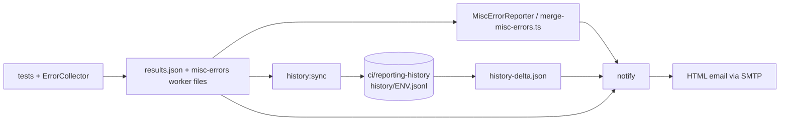

# Reporting and Notifications

> **Purpose:** How a test run becomes a summary email, a history ledger entry and a background-error report; what each `src/notifications` module owns.
> **Read when:** Changing anything under `src/notifications/`, `src/reporters/`, `src/error-collector/`, or `scripts/merge-misc-errors.ts`; debugging an odd email or an empty trend section.
> **Size budget:** 40k chars (hard cap 60k)
> **Last verified:** 2026-10-28 @ 566df8c

## 1. Data flow

Local runs trigger `notify` through `posttest` (skipped when `$CI` is set). In CI the GitHub workflows (`dev`, `qa`, `stage`, `prod`, `main`, `sandbox`, `staging-promotion-gate`), `Jenkinsfile` and `Jenkinsfile.sandbox` call `history:sync` (before `notify`) and `notify` explicitly; `Jenkinsfile.qa`, `Jenkinsfile.staging` and `Jenkinsfile.prod` call `history:sync` only (no email, by a recorded scoping decision). All with `|| true` so reporting never fails a build. Sharded workflows merge shard blob reports and misc-errors first; see [CI_PIPELINES.md](./CI_PIPELINES.md). A sharded Jenkins run does the same merge in the base `Jenkinsfile`'s `post` block, then calls `history:sync` and `notify` once (section 5.1 there).

## 2. Module ownership (`src/notifications/`)

| Module | Owns |
|---|---|
| `src/notifications/scripts/notify.ts` / `NotificationService.ts` | Orchestrates parse → history → analysis → render → send. Resolves branch/commit from CI env vars, then local `git`, then `unknown`. Freshness check. |
| `ReportParser.ts` | Parses Playwright's JSON report: totals, per-module stats (UI/RBAC split, retries genuine vs swept, slowest three tests), flaky tests, trace paths (last non-passing attempt for flaky), `error.stack`/`location`, ANSI stripping. Duration and start time come from `raw.stats`, not a sum of test durations. `deriveModuleFromFile()` is the single source of module display names. |
| `RunHistory.ts` | Pure logic: append/prune (`MAX_RECORDS_PER_ENV`), delta vs previous comparable run, recurring-flaky / recurring-failing (lookback and threshold constants), module trend and rolling module stability trend, slow-test regression, suite drift, duration estimate. |
| `FailureAnalyzer.ts` | Classifies each failure into a category and clusters only on a real shared signal (identical message, same source location, same endpoint + status). Never fuzzy-matches. |
| `FailureDetailBuilder.ts` | Enrichment: per-failure detail from history, the known-issues index and CI context. Raw fs access is isolated in a loader; derivation is pure. |
| `KnownIssuesIndex.ts` | Deterministic cross-reference of a failure against the issue docs. See §6. |
| `FailureClassifier.ts` | Pure logic: suspected-cause label, evidence lines and run summary per failed/flaky test, from the tracked registry. A hint only; see §6.1. |
| `FailureSignatureLoader.ts` | Reads and validates `failureSignatures.json`; a missing or invalid file degrades to an empty registry (every failure stays `unclassified`) and a log warning, never a blocked email. |
| `AutomationHealth.ts` | Weighted 0-100 score (Excellent / Good / Needs Attention / Critical) and the overall verdict, including the incomplete-run verdict (checked first), `no-tests-executed` (second) and suite drift. Weights are documented starting heuristics, not tuned constants. |
| `JobStats.ts` | GitHub Actions only: Jobs API → per-job durations, total job-minutes (completed jobs only), time-overlap detection between jobs, per-shard recovery-event rows. Degrades to `null` on any failure. |
| `EmailTemplate.ts` | HTML renderer: an orchestrator plus one `buildXxx()` per section; carries `REPORT_ENGINE_VERSION`, independent of `package.json`. |
| `src/notifications/config/notificationConfig.ts`, `adapters/EmailAdapter.ts` | SMTP settings (Gmail, Zoho fallback); recipients, cc and sender name come from `NOTIFY_TO` / `NOTIFY_CC` / `NOTIFY_FROM_NAME` (CI secrets, comma- or semicolon-separated; no address lives in source; `NOTIFY_ENABLED=false` disables notify entirely). `NOTIFY_TO` unset → a loud warning and send to `GMAIL_USER` only. Logs print recipient counts only (a re-joined list is not masked by GitHub). History-commit identity: `BOT_GIT_NAME` / `BOT_GIT_EMAIL` (noreply default). |
| `FieldConfigReset.ts` | Shared shape and loader for `reports/<env>/field-config-reset.json`, written by `scripts/reset-field-config.ts`; returns `null` on any problem so the email just omits the line. |
| `ShardCompleteness.ts` | Shape, parser and loader for `reports/<env>/shard-completeness.json` (expected vs merged shard reports, written by `.github/scripts/verify-shard-completeness.sh`). Missing or garbled file = no information, never "complete" or "incomplete". Optional `scoped` text (`isScopedRun()`): set by a sharded Jenkins `SHARDED_TEST` run that used `TEST_GREP`/`FF_ENTITIES`; it marks the run partial without making it incomplete. |
| `redact.ts` | `redactSensitiveText()`: secret scrubbing for text that goes into the email (error text, stack, misc errors, field-reset error). `syncHistory.ts` logs through its own local `redact()` and `registerSecretForRedaction`; `NotificationService` log lines do not pass through `redact.ts`. |

## 3. Email sections

In the order `EmailTemplate.html()` renders them: incomplete-run banner (only when shards are missing) · scoped-run banner (only for a `scoped` run: "Partial run — scoped test build: <TEST_GREP / FF_ENTITIES>"; the subject also gets a `🔎 PARTIAL (scoped run) — ` prefix) · stale-report warning (only when stale) · masthead with Automation Health · full-width status banner · suspected-environment banner (§6.1, only when one signature dominates) · colour-coded ENV / BRANCH / BUILD / SOURCE badges · Executive Summary (deployment recommendation, suite drift, clusters) · suspected-cause summary line (§6.1) · health score with factors · run metadata · KPI tiles (total, passed, failed, skipped, flaky, pass rate, duration, modules, retries with genuine vs swept split) and signal chips · trend (delta, pass-rate sparkline, recurring flaky/failing, modules trending worse) · Module Analytics (ranked by health; retries column; stability trend line) · Slowest Tests (whole run) and Slowest per module · CI Job Stats (GitHub only: per-job times, total job-minutes, time overlaps, load signals by job) · Flaky Tests with historical frequency · Skipped Tests · Failed Tests (clusters; each failure keeps full detail; "Related history" link when the index matches) · background errors (unexpected / Expected RBAC / Known background noise, app vs infra) · dedicated form-field reset line (informational only: one line when every field is blank (the email prints the count the reset file reports), a warning box listing failed fields or an unfinished reset; omitted when `reports/<env>/field-config-reset.json` is absent or the mode is `dry-run`; never changes verdict, health score or counts; `FieldConfigReset.ts`, [ADR 0009](./adr/0009-field-config-reset-and-account-lock.md); never viewed rendered) · Action Required · Environment · CI/CD and Artifacts (run URL, re-run link only when real, history-ledger link) · call-to-action buttons · footer.

## 4. Run history ledger (`ci/reporting-history`)

- One JSONL file per environment: `history/<env>.jsonl` on a dedicated, never-merged branch. Capped at the last `MAX_RECORDS_PER_ENV` records (oldest pruned on write). Chosen over a database or Actions cache because it survives across runners, needs no new infrastructure, and is plain-text and git-diffable (`git show origin/ci/reporting-history:history/qa.jsonl`).
- The ledger is keyed by app environment, not branch; dev and qa both use `ENV=qa`. Comparisons therefore filter by branch and scope (§5).
- `syncHistory.ts` clones into its own temp directory. **Auth:** it injects the same Basic-auth header `actions/checkout` uses through `GIT_CONFIG_*` env vars (never in a URL), from `PIPELINE_TOKEN` (GitHub) or the Jenkins `github-credentials` binding. Every logged string passes through a redactor. Workflows running it need `permissions: contents: write`.
- **Concurrent pushes:** on rejection it fetches, `reset --hard`s, recomputes the delta and appends again (a rebase produced unresolvable conflicts on the text ledger). Push failures are classified from the real captured git stderr into named classes; an unmatched error is `unclassified` and is not retried.
- **One record per build.** `buildNumber` is `GITHUB_RUN_NUMBER`, which a manual "re-run failed jobs" does not change, and each re-run re-executes `merge-and-report` (another email, another record). Sandbox Build #186 was re-run to attempt 7 and has 7 records (failed counts 66, 63, 49, 34, 18, 0, 0); counting them as 7 runs is what produced "49 recurring failures / 42 recurring flaky" on a 0-failed run. `appendAndPrune()` now replaces an earlier record of the same `runSource|branch|buildNumber`, and the delta, recurring-flaky/failing and module-trend readers go through `comparableHistory()` (same branch + scope, current build's earlier attempts removed, one record per build). Other readers filter differently: `computeSlowTestTrend` reads the raw prior history, `buildPassRateSeries` de-duplicates by build and drops `incomplete` records with no branch or scope filter, `computeDurationEstimate` filters by branch and workers, and `computeSuiteDrift` has its own path for dev-equivalent runs (§5). `local` builds are never collapsed. Records written before this change are de-duplicated on read, not rewritten.
- Each record stores: totals, failed/flaky titles, top slowest durations, per-module stats (with `type`), `workers`, `gitCommit`, `isDevEquivalentRun` and a normalized `scope`. Old records lack `scope` and simply never match. Sharded Jenkins runs also carry `lanes` (the `CI_LANES` env var the Jenkinsfile exports, for example `core=2,ff=2`, with `,scoped` for a scoped run); `computeDurationEstimate()` skips records that have it, so a sharded wall-clock never feeds an unsharded estimate. Absent on every other record.
- **Incomplete runs (2026-10-08).** When fewer shard reports were merged than expected, `computeOverallVerdict` returns `blocked` / danger with label "Incomplete Run — N of M shards reported" (subject says `INCOMPLETE RUN`, never green), and the email opens with an "Incomplete run: N of M shards reported" banner. `syncHistory` records the run with `incomplete: {expected, reported}` and writes an empty delta file for it (no delta, trend, recurring counts or drift for the partial run); `comparableHistory`, the pass-rate series and the duration estimate exclude `incomplete` records. A record already written without the field can be marked by hand (add the field to its JSON line) or removed; a complete re-run of the same build replaces it. Health score and test counts are shown unchanged (they cover only the shards that reported).
- A read-only `estimate-duration` step runs before the tests and prints an average of matching records (same branch and `workers`), or an honest "insufficient history".

## 5. Suite drift and scope

Drift is flagged when the current run has fewer tests than the previous comparable run (any decrease; growth is never flagged), because a missing test is often a silently broken file. "Comparable" means same branch AND same derived scope, except for a dev-equivalent run (`isDevEquivalentRun`, a run right after a reset to dev): `computeSuiteDrift` compares it with the most recent earlier dev-equivalent run of the same scope on any branch (basis `previous-reset-run`, or `no-reset-baseline-yet` when none exists), and the health note then reads "fewer test(s) ran than the last reset-to-dev run". `deriveTestScope()` computes scope from the run itself: the single `@tag` shared by every executed test (`common-tag`), else the sorted set of contributing modules (`module-set`), else `empty-report`. It is never configured per workflow, so a new branch or target needs no registration; a changed scope finds no prior record and stays silent. The verdict stays `blocked` but the banner tone is amber, not red.

### 5.1 Health score and verdict (`AutomationHealth.ts`)

Two separate things. **Verdict** (icon and PASSED/FAILED/UNSTABLE word in the subject and banner) comes only from this run's results: checked in this order in `computeOverallVerdict()`: missing shards (`🚫 Incomplete Run`, blocked), nothing executed (`🚫 No Tests Executed`, blocked: it verified nothing), any failed test (❌ red), suite drift (`Suite Drift Detected`, amber-blocked), any flaky test (amber `Unstable — N flaky`; the headline says when N is above `FLAKY_BUDGET`, 3), then a `Needs Attention` health label (caution `Passed`), else clear. Drift therefore outranks flaky. **Health** is its own labeled value (`Health: <label> <score>/100` in the subject, masthead and Health Score block). Score = 100 minus: pass rate over executed tests with flaky counted as passed (0.6 × shortfall), failures (3 each, cap 25), flaky (1.5 each, cap 15), suite drift, stale report (30), and the **context inputs** — unexpected background errors (0.5 each, cap 8), recurring failures (2 each, cap 8), recurring flaky (1 each, cap 5) — whose total is capped at `CONTEXT_PENALTY_CAP` (15; the give-back shows as a "Context cap" factor). A run with 0 failed tests that did execute tests cannot score below 50 (`ZERO_FAILURE_SCORE_FLOOR`, shown as a "Zero-failure floor" factor with the raw score); the floor does not apply to a no-tests-executed run. Every costed input keeps its own line in the Health Score block. Weights are proposed starting points, not tuned.

## 6. Known-issues cross-reference

`KnownIssuesIndex.ts` reads the issue docs (`docs/known-issues/*.md` and `docs/KNOWN_ISSUES_ACTIVE.md`) and builds candidates from two precise signals only: an exact backtick-quoted substring of at least 25 characters (generic Playwright messages such as `Test timeout of N ms exceeded` are denylisted), or an exact `Class.method` taken from the first `at Class.method (` frame of the error stack (`extractStackMethodName()`; no repo-frame filter). Each candidate carries its source `file` and line, and the email deep-links to `blob/<commit-sha>/<file>#L<line>`; the commit SHA, not a branch, so the link always shows the content as of that run. A missing file yields an empty index, never a failure. Consequence for authors: keep distinctive error strings and `Class.method()` names in backticks in incident entries.

### 6.1 Failure-cause classification (`FailureClassifier.ts`, `failureSignatures.json`)

**Hints only.** A label never feeds the verdict, health score, counts, notification dedup key, subject line or the history ledger; `EmailTemplate.ts` only renders it (header comment of `src/notifications/FailureClassifier.ts`). `NotificationService.ts` computes it inside a try/catch that only logs, so a failure there omits the labels and the email is otherwise unchanged. `scripts/check-failure-labels.ts` asserts that verdict, health, counts, dedup key, subject and unexpected errors are identical with and without labels, and with an unusable registry.

**Labels** (`SuspectedCause`): `environment-suspected`, `application-bug-suspected`, `test-or-code-suspected`, `flaky`, `unclassified` (the default). In the email a badge reads "suspected: environment", "suspected: application", "suspected: test/code", "flaky" or "unclassified"; the style is blue/slate on purpose, never the red/amber/green of the run status.

**How a label is chosen** (`assessCauses()`, run over the hard failures plus the flaky tests' failing attempt):
1. Each failure is matched against every registry signature (`matchSignature()`): its `errorPatterns` (case-insensitive regex over the error, all error attempts, stack and snippet) or its `misc` rule (a captured misc-error of the same test with matching HTTP status, API error code, URL pattern, method and optionally a response-body pattern).
2. A match counts only if the signature's breadth rule holds in this run (`minTests` tests across `minModules` modules), so one failing test alone never gets a cause. `orKnownIssue: true` waives the breadth when the failure also has a known-issue match (§6); the evidence line says so.
3. The first matching signature in registry order wins. A `flaky` test keeps the label `flaky`; its evidence adds which signature its failing attempt matched.
4. With no registry match, a locator or assertion failure with no captured HTTP error or failed request becomes `test-or-code-suspected`, with a note that an assertion mismatch can also mean the app changed. Anything else is `unclassified`.
5. If one environment signature dominates the run (below), `test-or-code-suspected` is demoted to `unclassified` with an evidence line saying why.
6. Context lines are appended without changing the label: "also failed in the previous comparable run", "failing in N of the last M runs".
Codes `01503001` and `029003` are listed under `ambiguousCodes` in the registry: they are noted in the evidence as ambiguous and never used as evidence. `MiscError.expectedReason` is deliberately not used either.

**Plain-language evidence.** Each registry pattern carries `errorPatternNotes` (one description per pattern, validated by `parseSignatureRegistry()`), and the evidence line quotes that note, never the matched text, so the email does not repeat codes, locators, stack text, record names or hostnames. Misc-based evidence shows the HTTP status, API code, method and URL path only (path passed through `redactSensitiveText()`). Each evidence line is cut at 300 characters in the card. Breadth is worded "N tests across M modules share it (X failed outright, Y passed on retry)".

**Failed vs retry split.** Everywhere a count appears it is split with `splitText()`: "N failed outright, M passed on retry". The summary line under the Executive Summary reads "Suspected cause of the N failures (hints, not verdicts): of the F that failed outright, N environment, N application, N test/code, N unclassified; R passed on retry (flaky)"; it adds "Run incomplete: counts cover only the shards that reported" when `shard-completeness.json` says so. The banner's count is `failed + retry` of the dominant signature, and its second line gives the run's own failed/retry totals, so banner and summary agree (asserted by the check script).

**Banner.** Directly under the status banner, shown when one `environment-suspected` signature has at least `minTests` matches and at least `DOMINANT_SHARE` (0.3) of all failed and flaky tests; the largest such signature is shown, with the date it was registered. Text: "Likely environment problem: X of Y failures share the signature ...". It states that the run status is unchanged.

**Dated Kylas-team observation.** A registry entry that is `confirmed` may carry `askKylasTeam` = `{ question, observation, observed }`. The banner prints the question and "Observed on <date> (a one-off manual check, not measured by this run): <observation>". It is a stored manual probe, not something the run measured; an unconfirmed signature gets the banner but no question or probe date, and a confirmed environment signature without `askKylasTeam` is rejected at load. Today only `search-lookup-miss` has one (observed 2026-10-15, ties to KI-43 in [KNOWN_ISSUES_ACTIVE.md](./KNOWN_ISSUES_ACTIVE.md)).

**Registry** (`src/notifications/failureSignatures.json`, tracked, `version` 1). Per signature: `id`, `title`, `label` (only `environment-suspected` or `application-bug-suspected`), `errorPatterns` + `errorPatternNotes` and/or `misc`, `minTests`, `minModules`, optional `orKnownIssue`, `kiRef`, `kiFile`, `added`, `confirmed`, optional `askKylasTeam`, `why`. Two entries (`products-put-500-00903002`, `contacts-post-400-000000-empty`, added 2026-10-21) still carry a `KI-TBD` placeholder `kiRef`. Add a signature only with live evidence from a real run, and widen it only with the same bar.

**`npm run check:failure-labels`** (`scripts/check-failure-labels.ts`; offline, no network, no email, no clock-dependent assertions, exit 1 on any failure). It checks: registry hygiene (each `kiFile` exists; it mentions the `kiRef` when that is a `KI-nn` id (the two `KI-TBD` entries skip this) and the error code when `misc.apiErrorCode` is set; ISO dates, one note per pattern, `01503001` and `029003` listed as ambiguous); a replay of the shapes of sandbox run 38690038228 through the real `ReportParser`, `FailureAnalyzer`, `FailureDetailBuilder`, `AutomationHealth` and `EmailTemplate` (labels, banner and summary arithmetic); one case per signature (breadth, flaky, single-test cases); evidence wording (no quoted code, locators or hostnames); the loader and validator with missing, invalid and valid registry files; and that verdict-side fields are unchanged by labels. Options: `--table` (label table of the replay), `--html` (HTML fragments for three cases), `--replay <specs.json>` (label table for a fixture of `{file,title,status,error,snippet?,misc?[]}`), `--detail` (per-test and per-cluster lines with `--replay`), `--snapshot <file>` (writes the computed verdict-side fields for a before/after diff). It needs no network and sends no email; it writes only temporary files under the OS temp directory. **Run it** after editing `FailureClassifier.ts`, `FailureSignatureLoader.ts`, `failureSignatures.json` or the cause rendering in `EmailTemplate.ts`, and before adding a signature. Nothing runs it automatically: it is in no workflow and no hook.

## 7. Background errors (`reports/<env>/misc-errors.json`)

Each worker's `ErrorCollector` writes `misc-errors-worker-<N>.json`; `MiscErrorReporter` merges them at run end (CI shards: `scripts/merge-misc-errors.ts` aggregates per-shard directories). Each error is classified as noise (dropped), Expected RBAC (HTTP 422 / code `029003`, 403 / `00902001`, permission-text patterns, driven by arrays that are now genuinely read), or Known background noise (a deliberately narrow, live-confirmed endpoint list; entity CRUD, detail, search and layout endpoints are never added, because a real outage there must surface). Widening the known-noise list needs the same live-evidence bar. The file is overwritten by every later run in that environment: copy it first. Recovery events (429 page, error boundary, `globalSetup` retries) are recorded per worker, merged, and shown per shard under "Load Signals by Job"; main-process events use `recovery-events-main.json`.

## 8. Freshness and rendering rules

- **Freshness:** if the report's end time is older than the stale threshold (default 4 hours, env `STALE_REPORT_THRESHOLD_HOURS`), the email gets a top warning, a subject prefix and a large health penalty.
- **Outlook desktop renders with Word's engine.** Use literal HTML `width` attributes (no reliance on `max-width`), solid opaque hex colours (never `rgba()`, which is silently dropped), and join badges with a real space character, not just CSS margin. The container is fluid by design. Emoji and symbols appear on the status banner, the SOURCE badge, the subject line (✅/❌/⚠️), the stale warning, the Module Analytics trend glyphs and the overlap flags. Dark mode is best-effort and not verified in real clients.
- **Traces:** failures retain trace, screenshot and video; the email shows repo-relative trace paths matching the downloaded artifact.

## 9. Open items

See [KNOWN_ISSUES_ACTIVE.md](./KNOWN_ISSUES_ACTIVE.md) (for example `console.*` still used in a few reporting scripts). Resolved history: [known-issues/reporting-and-notifications.md](./known-issues/reporting-and-notifications.md).
