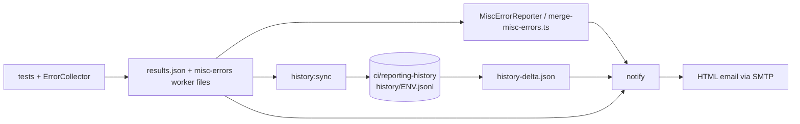

# Reporting and Notifications

> **Purpose:** How a test run becomes a summary email, a history ledger entry and a background-error report; what each `src/notifications` module owns.
> **Read when:** Changing anything under `src/notifications/`, `src/reporters/`, `src/error-collector/`, or `scripts/merge-misc-errors.ts`; debugging an odd email or an empty trend section.
> **Size budget:** 40k chars (hard cap 60k)
> **Last verified:** 2026-11-26 @ 3c48a02

## 1. Data flow

Local runs trigger `notify` through `posttest` (skipped when `$CI` is set). In CI the GitHub workflows (`dev`, `qa`, `stage`, `prod`, `main`, `sandbox`, `staging-promotion-gate`), `Jenkinsfile` and `Jenkinsfile.sandbox` call `history:sync` (before `notify`) and `notify` explicitly; `Jenkinsfile.qa`, `Jenkinsfile.staging` and `Jenkinsfile.prod` call `history:sync` only (no email, by a recorded scoping decision). All with `|| true` so reporting never fails a build. Sharded workflows merge shard blob reports and misc-errors first; see [CI_PIPELINES.md](./CI_PIPELINES.md). A sharded Jenkins run does the same merge in the base `Jenkinsfile`'s `post` block, then calls `history:sync` and `notify` once (section 5.1 there).

## 2. Module ownership (`src/notifications/`)

| Module | Owns |
|---|---|
| `src/notifications/scripts/notify.ts` / `NotificationService.ts` | Orchestrates parse → history → analysis → render → send. Resolves branch/commit from CI env vars, then local `git`, then `unknown`. Freshness check. |
| `ReportParser.ts` | Parses Playwright's JSON report: totals, per-module stats (UI/RBAC split, retries genuine vs swept, slowest three tests), flaky tests, trace paths (last non-passing attempt for flaky), `error.stack`/`location`, ANSI stripping. Duration and start time come from `raw.stats`, not a sum of test durations. `deriveModuleFromFile()` is the single source of module display names. |
| `RunHistory.ts` | Pure logic: append/prune (`MAX_RECORDS_PER_ENV`), delta vs previous comparable run, recurring-flaky / recurring-failing (lookback and threshold constants), module trend and rolling module stability trend, slow-test regression, suite drift, duration estimate. |
| `FailureAnalyzer.ts` | Classifies each failure into a category and clusters only on a real shared signal (identical message, same source location, same endpoint + status). Never fuzzy-matches. |
| `FailureDetailBuilder.ts` | Enrichment: per-failure detail from history, the known-issues index and CI context. Raw fs access is isolated in a loader; derivation is pure. |
| `KnownIssuesIndex.ts` | Deterministic cross-reference of a failure against the issue docs. See §6. |
| `FailureClassifier.ts` | Pure logic: suspected-cause label, evidence lines and run summary per failed/flaky test, from the tracked registry. A hint only; see §6.1. |
| `FailureSignatureLoader.ts` | Reads and validates `failureSignatures.json`; a missing or invalid file degrades to an empty registry (every failure stays `unclassified`) and a log warning, never a blocked email. |
| `AutomationHealth.ts` | Weighted 0-100 score (Excellent / Good / Needs Attention / Critical) and the overall verdict, including the incomplete-run verdict (checked first), `no-tests-executed` (second) and suite drift. Weights are documented starting heuristics, not tuned constants. |
| `JobStats.ts` | GitHub Actions only: Jobs API → per-job durations, total job-minutes (completed jobs only), time-overlap detection between jobs, per-shard recovery-event rows. Degrades to `null` on any failure. |
| `EmailTemplate.ts` | HTML renderer: an orchestrator plus one `buildXxx()` per section; carries `REPORT_ENGINE_VERSION`, independent of `package.json`. |
| `src/notifications/config/notificationConfig.ts`, `adapters/EmailAdapter.ts` | SMTP settings (Gmail, Zoho fallback); recipients, cc and sender name come from `NOTIFY_TO` / `NOTIFY_CC` / `NOTIFY_FROM_NAME` (CI secrets, comma- or semicolon-separated; no address lives in source; `NOTIFY_ENABLED=false` disables notify entirely). `NOTIFY_TO` unset → a loud warning and send to `GMAIL_USER` only. Logs print recipient counts only (a re-joined list is not masked by GitHub). History-commit identity: `BOT_GIT_NAME` / `BOT_GIT_EMAIL` (noreply default). |
| `FieldConfigReset.ts` | Shared shape and loader for `reports/<env>/field-config-reset.json`, written by `scripts/reset-field-config.ts`; returns `null` on any problem so the email just omits the line. |
| `ShardCompleteness.ts` | Shape, parser and loader for `reports/<env>/shard-completeness.json` (expected vs merged shard reports, written by `.github/scripts/verify-shard-completeness.sh`). Missing or garbled file = no information, never "complete" or "incomplete". Optional `scoped` text (`isScopedRun()`): set by a sharded Jenkins `SHARDED_TEST` run that used `TEST_GREP`/`FF_ENTITIES`; it marks the run partial without making it incomplete. |
| `redact.ts` | `redactSensitiveText()`: secret scrubbing for text that goes into the email (error text, stack, misc errors, field-reset error). `syncHistory.ts` logs through its own local `redact()` and `registerSecretForRedaction`; `NotificationService` log lines do not pass through `redact.ts`. |

## 3. Email sections

In the order `EmailTemplate.html()` renders them: incomplete-run banner (only when shards are missing) · scoped-run banner (only for a `scoped` run: "Partial run — scoped test build: <TEST_GREP / FF_ENTITIES>"; the subject also gets a `🔎 PARTIAL (scoped run) — ` prefix) · stale-report warning (only when stale) · masthead with Automation Health · full-width status banner · suspected-environment banner (§6.1, only when one signature dominates) · colour-coded ENV / BRANCH / BUILD / SOURCE badges · Executive Summary (deployment recommendation, suite drift, clusters) · suspected-cause summary line (§6.1) · health score with factors · run metadata · KPI tiles (total, passed, failed, skipped, flaky, pass rate, duration, modules, retries with genuine vs swept split) and signal chips · trend (delta, pass-rate sparkline, recurring flaky/failing, modules trending worse) · Module Analytics (ranked by health; retries column; stability trend line) · Slowest Tests (whole run) and Slowest per module · CI Job Stats (GitHub only: per-job times, total job-minutes, time overlaps, load signals by job) · Flaky Tests with historical frequency · Skipped Tests · Failed Tests (clusters; each failure keeps full detail; "Related history" link when the index matches) · background errors (unexpected / Expected RBAC / Known background noise, app vs infra) · dedicated form-field reset line (informational only: one line when every field is blank (the email prints the count the reset file reports), a warning box listing failed fields or an unfinished reset; omitted when `reports/<env>/field-config-reset.json` is absent or the mode is `dry-run`; never changes verdict, health score or counts; `FieldConfigReset.ts`, [ADR 0009](./adr/0009-field-config-reset-and-account-lock.md); never viewed rendered) · Action Required · Environment · CI/CD and Artifacts (run URL, re-run link only when real, history-ledger link) · call-to-action buttons · footer.

### 3.1 Rerun section (ADR 0015, sandbox first)

`src/notifications/RerunSummary.ts` reads `reports/<env>/rerun-summary.json`, written by `scripts/combine-rerun.ts` in `merge-and-report`; no file (kill switch `RERUN_SHARD` off, older run) means no rerun section and an email identical to before. With it: one section "Rerun of failed and flaky tests" with the table **"First run | Final result"**, one row per rerun test (first run → rerun → final: Passed on rerun, Passed after an in-job retry, Failed, Not run), and the same line on each card; a "Passed on rerun (N)" section keeps the first-run failure of the tests that passed on the rerun; tests that were not rerun are listed per selector reason; if nothing was rerun it says why.

**The Final result rule (second amendment of [ADR 0015](./adr/0015-skip-passed-formfields-on-rerun-and-rerun-shard.md), 2026-11-24).** The Final result column counts how tests ENDED: every test that ultimately passed is Passed, whether it passed clean, after an in-job retry (flaky) or on the rerun; Flaky is 0 there (note "(the 6 ended Passed)"). "Flaky" is a signal INSIDE Passed, never a second outcome. The breakdown is disjoint everywhere (table note, Passed tile, executive summary, module rows, subject): **Passed = clean + after a retry (`firstRun.flaky`, whether or not the rerun confirmed it) + after the rerun (failed every first attempt, `recoveredOnRerun`) + ran only on the rerun**. Build #235: 940 = 932 + 6 + 2. **Which numbers each part uses:** Final result (`ParsedReport.finalPassed`, `failed`): the Passed and Failed tiles, the table, the executive summary, the subject, the health pass-rate factor and `afterRerun` in history; first run (`ParsedReport.firstRun`): the First run column, "Passed first time" and its delta and series, the Flaky tile (6), the Flaky Tests section, the Trend deltas, module trends, and the history counts (`passed`/`failed`/`flaky`/`skipped`); verdict: red if anything failed in the end, amber if any test is still flaky, failed every first attempt and passed on the rerun (D2), did not run or ran only on the rerun, green otherwise. **Tiles:** Total, Passed (breakdown), Failed, Skipped (and Did not run) add up to Total; Flaky sits in the second row as a signal. **Subject:** `❌ STAGING sandbox #235: 2 failed, 940 passed (6 flaky, 2 on rerun) of 943` (counts, then the instability inside Passed; a blocked, incomplete or empty run names itself instead; the health score is in the body). **Module Analytics:** "Pass (final)" with "N needed a retry or rerun" inside it, and Fail. **`npm run check:scenarios`** replays about 35 described runs (all pass, flaky only, failures that pass or fail on the rerun, serial files, formFields, skips, did-not-run, incomplete, blocked by renew-session, no report, 0 tests, a very bad run, every branch and environment, and build #235) through the real pipeline, asserts the same invariants on every one (numbers agree across subject, tiles, table, summary and history; a failure is never green; flaky stays visible; a run where nothing ran claims no pass rate; under 100 KiB), prints the matrix and, with `--out <dir>`, writes each email as HTML plus an index. Findings it lists but does not fail on are in its `KNOWN` list. History: `passed`/`failed`/`flaky`/`skipped` and per-module counts are first-run, `afterRerun` is the Final result (940 / 2 / 0), `flakyTestTitles` includes every test that needed a retry or the rerun, `failedTestTitles` only those still failing; records before 2026-11-24 hold other counts. **`npm run check:rerun`** tests selection, combination and 21 scenarios; **`npm run check:build235`** replays the real build #235 from `scripts/fixtures/build-235`; `npm run check:failure-labels` covers the rendering.

**Rerun colour rules (2026-11-03, amended 2026-11-24):** a first run with only flaky tests is rerun on those; all passing = green; any failing = amber. A first run with failed/timed-out/did-not-run tests reruns only those: failed after the rerun = red; a test that failed every first attempt and passed only on the rerun, or a flaky test not rerun, = amber ("Unstable — N flaky, M passed only on rerun"). Tests that did not run (no skip annotation) or ran only on the rerun make a failure-free run amber; the Skipped tile counts deliberate skips only and "Did not run" has its own tile, so the outcome tiles add up to Total.

**Email review of build #235 (2026-11-24, commit 1; each covered by `check:build235`):** (1) the rerun counting above; (2) **Load Signals** counted only `RecoveryEvent`s from `withRateLimitRecovery` and globalSetup, so the fail-fast `explainAppErrorPage` path (429 page, error page) and API responses with status 429 (dropped by the `HTTP 429` noise filter) were never counted, `error-boundary-page` was emitted nowhere, and the rerun job's misc errors were never merged ("(no shard data)"): now `explainAppErrorPage` and the boundary throw record events, `ErrorCollector.capture` records an `api-429` event before the noise filter (still not an error entry), the table has "429 page" and "429 API" columns, and `merge-and-report` downloads `rerun-misc-errors-sandbox` as shard `sandbox-rerun` (its background errors are counted from now on); (3) the "Passed first time" series is limited to the run's own branch and run source and sorted by run time (build #214 was a `stage` run); (4) Module Analytics says "unstable this run: N of M" from the first-run counts and shows the 10-run window under its own label ("last N runs: N% unstable, getting worse / no clear trend / getting better"), in separate "vs last run" and "Stability" columns; (5) Background Errors shows "N unexpected + N expected RBAC + N known background noise = total" and a chip for the known noise (the classification was right: only unexpected errors count towards the score); (6) "Suspected cause of the 2 failures and 8 flaky tests"; (11) not-rerun tests are listed with the selector's reason; (12) the Skipped section reads the `skip`, `fixme` or `skip-reason` annotation, and `check:conventions` rule `skip-without-reason` requires `{ annotation: { type: 'skip-reason', description } }` on every unconditional `test.skip('title', …)` / `test.fixme('title', …)` (checked with Playwright 1.60 `--list`).

**Email review 2026-11-03 (fixed, each covered by `check:failure-labels`):** a serial dependent that did not run (`[skipped, skipped]` results) no longer counts as a retry, so it is not reported as "passed every attempt but swept" (`ReportParser.ts`); "1 retry" / "2 retries" (was "2 retry"); a flaky row without a detail card no longer renders an empty `id=""`; the dedup key includes the flaky count. **Follow-up fixes (same day):** the two pass-rate numbers are now labelled by what they measure (KPI tile and trend "Passed first time" = passed / all tests; Health factor "Passed incl. flaky" = (passed + flaky) / executed); a flaky test is worded "passed on retry" or "passed only on the rerun" by what happened (`TestResult.recoveredOnRerun`, `splitText`, cards, banner and summary line; "recovered on rerun" until 2026-11-24). **Seen, not changed** (listed in [BRANCH_STATUS](./BRANCH_STATUS.md)): JobStats shows only the latest attempt's jobs; the "Artifacts:" line shows a runner path, not a link.

Run Details shows two labelled clocks (2026-11-26, `RunTimes.ts`): "Run" = the workflow (GitHub `run_started_at`, else the first job's start; Jenkins `RUN_STARTED_AT_MS`) to the moment the email is generated, and "Tests" = first attempt start to last attempt end (`ReportParser.testsStart/testsEnd`).

Account capacity (`AccountCapacity.ts`, ADR 0019): a warnings banner near the top and a section after Module Analytics, built from the earliest pre-run snapshot and the latest post-run reading of the shards (artifacts `capacity-<env>-*`); billing figures are labelled "as of the last refresh" and "created during this run" comes from live per-entity counts (`liveCounts.ts`); a gate stop turns the email into BLOCKED. Missing data renders one "capacity data unavailable" line.

## 4–5. Run history ledger; suite drift and scope

Moved verbatim to [REPORTING_HISTORY.md](./REPORTING_HISTORY.md) (2026-11-26, size budget).

## 6. Known-issues cross-reference

`KnownIssuesIndex.ts` reads the issue docs (`docs/known-issues/*.md` and `docs/KNOWN_ISSUES_ACTIVE.md`) and builds candidates from two precise signals only: an exact backtick-quoted substring of at least 25 characters (generic Playwright messages such as `Test timeout of N ms exceeded` are denylisted), or an exact `Class.method` taken from the first `at Class.method (` frame of the error stack (`extractStackMethodName()`; no repo-frame filter). Each candidate carries its source `file` and line, and the email deep-links to `blob/<commit-sha>/<file>#L<line>`; the commit SHA, not a branch, so the link always shows the content as of that run. A missing file yields an empty index, never a failure. Consequence for authors: keep distinctive error strings and `Class.method()` names in backticks in incident entries.

### 6.1 Failure-cause classification (`FailureClassifier.ts`, `failureSignatures.json`)

**Hints only.** A label never feeds the verdict, health score, counts, notification dedup key, subject line or the history ledger; `EmailTemplate.ts` only renders it (header comment of `src/notifications/FailureClassifier.ts`). `NotificationService.ts` computes it inside a try/catch that only logs, so a failure there omits the labels and the email is otherwise unchanged. `scripts/check-failure-labels.ts` asserts that verdict, health, counts, dedup key, subject and unexpected errors are identical with and without labels, and with an unusable registry.

**Labels** (`SuspectedCause`): `environment-suspected`, `application-bug-suspected`, `test-or-code-suspected`, `flaky`, `unclassified` (the default). In the email a badge reads "suspected: environment", "suspected: application", "suspected: test/code", "flaky" or "unclassified"; the style is blue/slate on purpose, never the red/amber/green of the run status.

**How a label is chosen** (`assessCauses()`, run over the hard failures plus the flaky tests' failing attempt):
1. Each failure is matched against every registry signature (`matchSignature()`): its `errorPatterns` (case-insensitive regex over the error, all error attempts, stack and snippet) or its `misc` rule (a captured misc-error of the same test with matching HTTP status, API error code, URL pattern, method and optionally a response-body pattern).
2. A match counts only if the signature's breadth rule holds in this run (`minTests` tests across `minModules` modules), so one failing test alone never gets a cause. `orKnownIssue: true` waives the breadth when the failure also has a known-issue match (§6); the evidence line says so.
3. The first matching signature in registry order wins. A `flaky` test keeps the label `flaky`; its evidence adds which signature its failing attempt matched.
4. With no registry match, a locator or assertion failure with no captured HTTP error or failed request becomes `test-or-code-suspected`, with a note that an assertion mismatch can also mean the app changed. Anything else is `unclassified`.
5. If one environment signature dominates the run (below), `test-or-code-suspected` is demoted to `unclassified` with an evidence line saying why.
6. Context lines are appended without changing the label: "also failed in the previous comparable run", "failing in N of the last M runs".
Codes `01503001` and `029003` are listed under `ambiguousCodes` in the registry: they are noted in the evidence as ambiguous and never used as evidence. `MiscError.expectedReason` is deliberately not used either.

**Plain-language evidence.** Each registry pattern carries `errorPatternNotes` (one description per pattern, validated by `parseSignatureRegistry()`), and the evidence line quotes that note, never the matched text, so the email does not repeat codes, locators, stack text, record names or hostnames. Misc-based evidence shows the HTTP status, API code, method and URL path only (path passed through `redactSensitiveText()`). Each evidence line is cut at 300 characters in the card. Breadth is worded "N tests across M modules share it (X failed outright, Y passed on retry)".

**Failed vs retry split.** Everywhere a count appears it is split with `splitText()`: "N failed outright, M passed on retry". The summary line under the Executive Summary reads "Suspected cause of the N failures (hints, not verdicts): of the F that failed outright, N environment, N application, N test/code, N unclassified; R passed on retry (flaky)"; it adds "Run incomplete: counts cover only the shards that reported" when `shard-completeness.json` says so. The banner's count is `failed + retry` of the dominant signature, and its second line gives the run's own failed/retry totals, so banner and summary agree (asserted by the check script).

**Banner.** Directly under the status banner, shown when one `environment-suspected` signature has at least `minTests` matches and at least `DOMINANT_SHARE` (0.3) of all failed and flaky tests; the largest such signature is shown, with the date it was registered. Text: "Likely environment problem: X of Y failures share the signature ...". It states that the run status is unchanged.

**Dated Kylas-team observation.** A registry entry that is `confirmed` may carry `askKylasTeam` = `{ question, observation, observed }`. The banner prints the question and "Observed on <date> (a one-off manual check, not measured by this run): <observation>". It is a stored manual probe, not something the run measured; an unconfirmed signature gets the banner but no question or probe date, and a confirmed environment signature without `askKylasTeam` is rejected at load. Today only `search-lookup-miss` has one (observed 2026-10-15, ties to KI-43 in [KNOWN_ISSUES_ACTIVE.md](./KNOWN_ISSUES_ACTIVE.md)).

**Registry** (`src/notifications/failureSignatures.json`, tracked, `version` 1). Per signature: `id`, `title`, `label` (only `environment-suspected` or `application-bug-suspected`), `errorPatterns` + `errorPatternNotes` and/or `misc`, `minTests`, `minModules`, optional `orKnownIssue`, `kiRef`, `kiFile`, `added`, `confirmed`, optional `askKylasTeam`, `why`. Two entries (`products-put-500-00903002`, `contacts-post-400-000000-empty`, added 2026-10-21) still carry a `KI-TBD` placeholder `kiRef`. Add a signature only with live evidence from a real run, and widen it only with the same bar.

**`npm run check:failure-labels`** (`scripts/check-failure-labels.ts`; offline, no network, no email, no clock-dependent assertions, exit 1 on any failure). It checks: registry hygiene (each `kiFile` exists; it mentions the `kiRef` when that is a `KI-nn` id (the two `KI-TBD` entries skip this) and the error code when `misc.apiErrorCode` is set; ISO dates, one note per pattern, `01503001` and `029003` listed as ambiguous); a replay of the shapes of sandbox run 38690038228 through the real `ReportParser`, `FailureAnalyzer`, `FailureDetailBuilder`, `AutomationHealth` and `EmailTemplate` (labels, banner and summary arithmetic); one case per signature (breadth, flaky, single-test cases); evidence wording (no quoted code, locators or hostnames); the loader and validator with missing, invalid and valid registry files; and that verdict-side fields are unchanged by labels. Options: `--table` (label table of the replay), `--html` (HTML fragments for three cases), `--replay <specs.json>` (label table for a fixture of `{file,title,status,error,snippet?,misc?[]}`), `--detail` (per-test and per-cluster lines with `--replay`), `--snapshot <file>` (writes the computed verdict-side fields for a before/after diff). It needs no network and sends no email; it writes only temporary files under the OS temp directory. **Run it** after editing `FailureClassifier.ts`, `FailureSignatureLoader.ts`, `failureSignatures.json` or the cause rendering in `EmailTemplate.ts`, and before adding a signature. Nothing runs it automatically: it is in no workflow and no hook.

## 7. Background errors (`reports/<env>/misc-errors.json`)

Each worker's `ErrorCollector` writes `misc-errors-worker-<N>.json`; `MiscErrorReporter` merges them at run end (CI shards: `scripts/merge-misc-errors.ts` aggregates per-shard directories). Each error is classified as noise (dropped), Expected RBAC (HTTP 422 / code `029003`, 403 / `00902001`, permission-text patterns, driven by arrays that are now genuinely read), or Known background noise (a deliberately narrow, live-confirmed endpoint list; entity CRUD, detail, search and layout endpoints are never added, because a real outage there must surface). Widening the known-noise list needs the same live-evidence bar. The file is overwritten by every later run in that environment: copy it first. Recovery events (429 page, error boundary, `globalSetup` retries) are recorded per worker, merged, and shown per shard under "Load Signals by Job"; main-process events use `recovery-events-main.json`.

## 8. Freshness and rendering rules

- **Freshness:** if the report's end time is older than the stale threshold (default 4 hours, env `STALE_REPORT_THRESHOLD_HOURS`), the email gets a top warning, a subject prefix and a large health penalty.
- **Outlook desktop renders with Word's engine.** Use literal HTML `width` attributes (no reliance on `max-width`), solid opaque hex colours (never `rgba()`, which is silently dropped), and join badges with a real space character, not just CSS margin. The container is fluid by design. Emoji and symbols appear on the status banner, the SOURCE badge, the subject line (✅/❌/⚠️), the stale warning, the Module Analytics trend glyphs and the overlap flags. Dark mode is best-effort and not verified in real clients.
- **Traces:** failures retain trace, screenshot and video, in the report artifact. The email does not print their paths (they open nothing from an inbox): each failure section says once where the artifact is (the run page, Artifacts, `playwright-report-…`).
- **Reader aids (commit 3 of the build #235 review, 2026-11-25):** the subject is factual (`❌ STAGING sandbox #235: 2 failed, 940 passed (6 flaky, 2 on rerun), 1 skipped of 943`; health stays in the body). The advice follows the promotion chain (`branchAdvice()`): sandbox and `feature/*` "... for a PR to dev", dev "... to promote to qa", qa to stage, stage to prod, prod to main, main (and any other branch) deployment wording; the summary agrees with the count ("review it" / "review them"). Every failed test card and "same cause" line carries `ENV=<env> npx playwright test tests/<file>:<line> --project=chromium --retries=0`. The commit is a GitHub link with subject and author (`git show -s` in the notify step). Every time is IST and says so; durations read "6m 10s"; every arrow has words. `KI-nn` references link to their topic file (`locateKnownIssues()`). **Flakiest tests, last 10 runs**: flaky in at least 2 of the last 10 comparable runs (`flakiestTests`, top 6); the health score reads the stricter `recurringFlaky`.
- **All modules table and size (piece E, 2026-11-25):** Module Analytics keeps its rows for modules with news (no row cap) and ends with **All N modules, UI and RBAC side by side**: one row per entity, per side Tests | First | Retry | Rerun | Failed | Skip | Unstable over the last runs (the stability main showed for every module); problem cells are highlighted, problem rows first; invariants `all-modules-*`. **Styles:** `EmailTemplate.compactStyles()` moves every inline style used twice or more into a short class (`x0`, `x1`, ...) of the head `<style>` block (-37%); `html()` is what is sent, `htmlReadable()` the same with styles inline (what the checks parse), `styles-roundtrip` proves nothing was changed; tile cells, bar cells, swatches and images keep their style inline. **Nothing is capped for size (corrected 2026-11-25):** every failed and flaky test keeps its full card (a cluster with one cause still has one full card plus one line per other test), and no list is truncated (trend, flakiest, action items, job rows, rerun rows, error groups, module rows, the plain-text part). A very bad run may pass Gmail's clip ("View entire message"; worst case 326.7 KiB); the essentials come first (verdict, tiles, How the run ended, Action Required, Module Analytics: they end by 27 KiB even there) and the cards and long lists follow. Normal runs stay under `EMAIL_SIZE_TARGET` (100 KiB) because of the style compaction.
- **Build #240 fixes (piece D, 2026-11-25; `check:build240`, fixture `build-240`):** the commit line shows the feature head in CI (the notify checkout was shallow; `resolveCommit()` fetches the merge's second parent, and the `merge-and-report` jobs of sandbox, qa, stage and main use `fetch-depth: 0`); not-rerun tests are explained in plain words; verb agreement is an invariant (`count-agreement`); a missing request start time is "at an unknown time" (`requestAge.ts`); Load Signals counts 429s by host: "429 Kylas API" is real throttling, "429 third-party" (Sentry, `THIRD_PARTY_HOST_PATTERNS`) is noise, an unlisted host counts as the Kylas API.
- **Data fixes from the build #239 review (piece 1, 2026-11-25):** an expected failure (`test.fail()`) is Passed first time (`ReportParser` reads `test.expectedStatus`); the cause line counts by first-run outcome; a slow-test regression needs more than the median slowdown of all slow tests × 1.2 **and** 60 s within the last 5 runs (`computeSlowTestTrend`); a merge commit shows the feature head (`CommitInfo.ts`); `GET /v1/(leads|deals)/<id>/pipeline` answering "There is no pipeline attached" is known background noise (`errorFilters.ts`). `check:build239` replays the run from `scripts/fixtures/build-239`.
- **"How the run ended" card, segmented bar and error tiles (piece B, 2026-11-25, [ADR 0018](adr/0018-outcome-donut-png.md)):** under the Run Summary tiles, one card. Left (about 40%): a nested table with the donut (Passed first time, Passed on retry, Passed on rerun, Failed, Skipped, in the tile colours), "99.7% first time" as HTML text under it, and the legend beside it (each count next to its label), vertically centred. Right (about 60%): the Rerun Summary tiles, 3 per row; without a rerun the donut and legend are centred (no empty half). A segmented bar of coloured table cells (visible with images blocked) runs under both. The donut is a text-free 340 px PNG shown at 170 px, drawn in-process (`DonutChart.ts`, Node `zlib`, no dependency, ~40-100 ms, 4-8 KB), sent as an inline CID attachment with alt text stating the numbers; if it cannot be made, one warning is logged and the email goes out without it (legend, figure and bar stay). Phones: the donut shrinks to 110 px beside its legend, the halves stack. The First run -> Final result counts stay in the Rerun section, written in plain words (no "rerun shard", "in-job retries"). The Background Errors counts are solid tiles (Unexpected red, Expected RBAC info colour, Known noise slate) with a bar of their shares. Invariants `chart-*`, `bar-*`, `error-*`; `check:donut`.
- **Review tools (piece C, 2026-11-25):** `npm run email:screens` renders the key scenarios and the real builds at 1200 and 375 px, light and dark, into `~/build239-render/screens/` (fails on a sideways scroll). `npm run check:email-safety` lints every rendered email and the template source for what Gmail or Outlook drop: odd tags, scripts, svg, images other than `cid:` (with alt and size), flex, grid, position, float, `calc()`, gradients, web fonts, a `<style>` block beyond cosmetics and the phone query. `npm run email:preview -- --to <address> --fixture build-239|build-235|build-235-blocked|worst-case [--dry-run]` sends a fixture email (donut as a real inline attachment) with the notify step's mail settings to that one address only (no cc, the normal recipients are never read), subject `[PREVIEW] ...`; `check:email-preview` tests it.
- **Visual polish (piece A, 2026-11-25; layout, order and wording unchanged):** solid colour-filled tiles in one semantic system: green passed, red failed, slate Skipped, grey zero or n/a (white text), retry / flaky yellow everywhere (tile, donut, legend, bar, pills), and information tiles plus the ENV badge in the environment's colour (QA sky blue, STAGING lavender, PROD deeper blue `#0C6FAC` with white text, unknown slate); one place defines both (`EmailPalette.ts`), contrast at least 4.5:1 is checked; the **Rerun Summary** tiles (only when a rerun ran) are the right half of the card below; section icons and dividers, status pills, error cards that lead with the message, a quiet footer; no flex. Phones: tiles two per row, secondary columns (`.mh`) hidden, no sideways scroll at 375 px. Tile numbers are bold sans-serif; repeated styles are classes in the head `<style>` (size). Invariants: `rerun-tiles-*`, `subject-matches-tiles`, `info-colour-per-env`, `retry-yellow`, `status-colour-constant`.
- **Size (commit 2, 2026-11-25; Gmail clips at about 100 KB, build #235 was 456 KB):** see the piece E bullet above for the current rules. Each error appears once (message and one short code frame; no stack frames). A cluster of tests with one cause gets one full card and one line per other test. CI Job Stats shows the real overlap anomalies only (same module at the same time). Background errors are grouped by method + endpoint (ids as `{id}`) + status; the full list is `background-errors.html`, written next to the HTML report by NotificationService and uploaded with it. Top of the email: three lines (Result, Action, Run). A plain-text part (`EmailTemplate.text()`, multipart/alternative) carries the same facts. `npm run check:email-size` fails above 100 KiB on the build #235 replay and its blocked variant, and only reports the worst case (60 failed, 80 flaky, 790 background errors).

## 9. Open items

See [KNOWN_ISSUES_ACTIVE.md](./KNOWN_ISSUES_ACTIVE.md) (for example `console.*` still used in a few reporting scripts). Resolved history: [known-issues/reporting-and-notifications.md](./known-issues/reporting-and-notifications.md).
